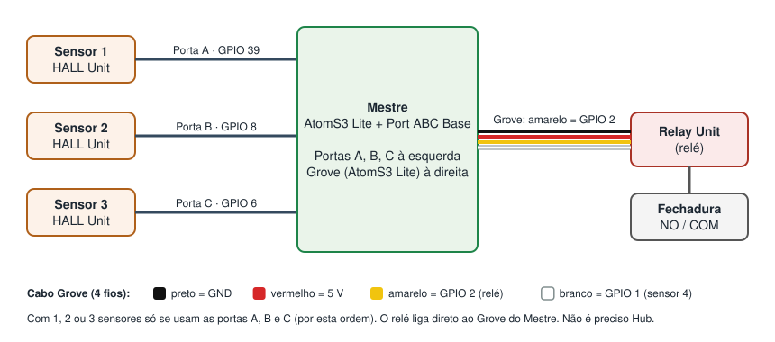
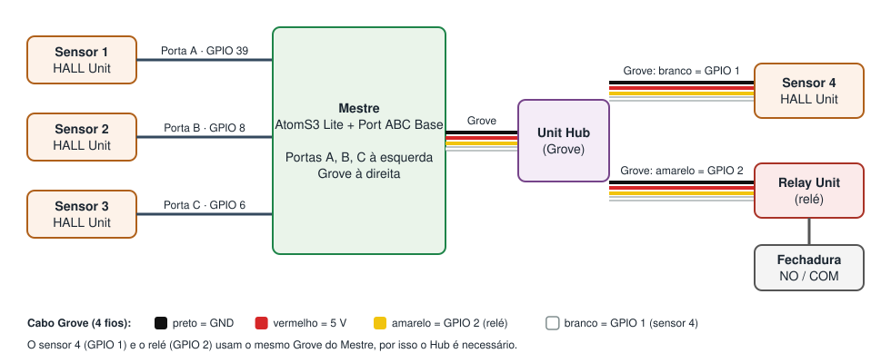
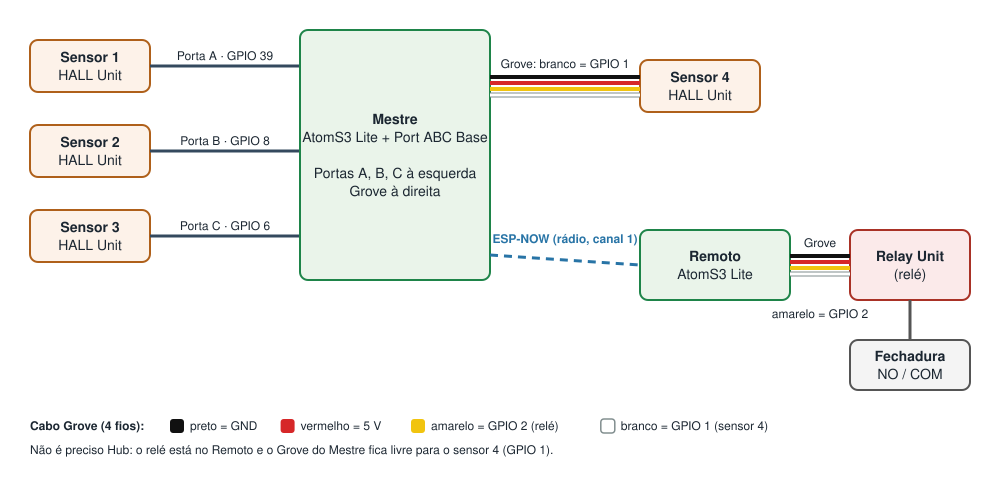

# Manual de instalação — Fechadura por sensores HALL (RSwitchE-Lock)

Este manual é para quem monta, programa e põe o sistema em funcionamento: ligações, firmware e primeira colocação em funcionamento. O uso no dia a dia está no [manual de utilização](Manual_Utilizacao.md). A especificação funcional está no [`SPEC.md`](SPEC.md).

Não cobre a fixação mecânica, a fechadura eletromagnética nem a sua alimentação.

## 1. Material

O sistema tem duas instalações possíveis, escolhidas na webapp (secção 3). O firmware do Mestre é o mesmo nas duas.

| Instalação | Componentes |
|---|---|
| **Local** (de fábrica) | [AtomS3 Lite](https://docs.m5stack.com/en/core/AtomS3-Lite), [Atomic Port ABC Base](https://docs.m5stack.com/en/atom/Atomic_Port_ABC_Base), 4 × [HALL Unit](https://docs.m5stack.com/en/unit/Unit_Hall), [Relay Unit](https://docs.m5stack.com/en/unit/Unit_Relay); [Unit Hub](https://docs.m5stack.com/en/unit/Unit_Hub) **só com 4 sensores** |
| **Remota** | O Mestre com os sensores (1 a 4 × HALL Unit), **sem Relay Unit e sem Hub**, mais um segundo AtomS3 Lite (o **Remoto**) com a Relay Unit |

Também precisa de:
- cabos Grove HY2.0-4P (um por unidade);
- alimentação USB-C de 5 V para cada AtomS3 Lite, com um cabo USB-C **de dados** para programar;
- um computador com o Arduino IDE ou o `arduino-cli`, e um telemóvel para a webapp;
- os ímanes e as peças do jogo (o sistema só lê se há ou não íman junto de cada sensor).

## 2. Ligações

Os cabos Grove têm quatro fios: preto (GND), vermelho (5 V), amarelo e branco.

### 2.1 Sensores HALL

Encaixe o AtomS3 Lite na Port ABC Base. Os sensores 1 a 3 ligam às portas da base e o sensor 4 liga à porta Grove do próprio AtomS3 Lite (direto, ou pelo Hub no modo local, ver a secção 2.2):

| Sensor | Ligação | GPIO |
|---|---|---|
| 1 | Porta **A** da Port ABC | 39 |
| 2 | Porta **B** da Port ABC | 8 |
| 3 | Porta **C** da Port ABC | 6 |
| 4 | Grove do AtomS3 Lite, fio **branco** | 1 |

Com N sensores em uso, o jogo lê os sensores 1 a N. Ligue por ordem, sem saltar números:

| Quantos sensores | Ligue às portas | Número de sensores em uso (Ajustes) |
|---|---|---|
| 1 | A | 1 |
| 2 | A e B | 2 |
| 3 | A, B e C | 3 |
| 4 | A, B, C e Grove | 4 |

Um sensor ligado a uma porta de número acima de N é ignorado.

### 2.2 Relé

| Instalação | Onde liga a Relay Unit | GPIO |
|---|---|---|
| Local | Grove do AtomS3 Lite do Mestre (direto com 1 a 3 sensores, pelo Hub com 4), fio **amarelo** (DIN) | 2 |
| Remota | Grove do AtomS3 Lite do **Remoto**, fio **amarelo** (DIN) | 2 |

A fechadura liga à Relay Unit pelos contactos **NO** e **COM**. O relé é ativado com nível HIGH e está em repouso com LOW. A lógica do relé não é configurável.

**Quando é preciso o Hub** (o sensor 4 usa o GPIO 1 e o relé o GPIO 2, ambos no Grove do Mestre):

| Instalação | Sensores | Hub |
|---|---|---|
| Local | 1 a 3 | **Não é necessário.** O relé liga direto ao Grove do Mestre (GPIO 2). |
| Local | 4 | **Necessário.** O sensor 4 e o relé precisam do Grove ao mesmo tempo. |
| Remota | 1 a 4 | **Não é necessário.** O relé está no Remoto e o Grove do Mestre fica livre para o sensor 4. |

### 2.3 Diagramas de ligação

Diagramas esquemáticos feitos para este projeto. Os GPIO são os do firmware. Nos cabos Grove, o preto é GND, o vermelho 5 V, o amarelo o GPIO 2 (relé) e o branco o GPIO 1 (sensor 4).

**Figura 1 — Local, 1 a 3 sensores (sem Hub):**



**Figura 2 — Local, 4 sensores (com Hub):**



**Figura 3 — Remoto (Mestre com os sensores, Remoto com o relé):**



### 2.4 Remoto

O Remoto é um AtomS3 Lite só com a Relay Unit na porta Grove. Não tem Port ABC nem sensores. O botão do Remoto não tem função.

## 3. Instalação local ou remota

A escolha faz-se na webapp, em **Ajustes › Instalação › Relé** (ver o manual de utilização):

- **Local (Relay Unit no Mestre):** de fábrica. O ESP-NOW e o heartbeat ficam inativos.
- **Remoto (ESP-NOW):** a ordem de abrir ou repousar o relé segue por rádio para o Remoto.

Regras:
- Só se pode mudar com o jogo **Armado**. Fora disso, a webapp recusa.
- Aplicar **reinicia o Mestre** e o ponto de acesso desliga-se. Volte a ligá-lo com um toque longo no botão.
- A escolha fica guardada e mantém-se depois de desligar a corrente. A reposição dos valores de fábrica **não** a altera.
- Um Mestre novo, ou apagado, arranca em **local**.

## 4. Firmware

O firmware do Mestre está em `Webapp/` (`Webapp.ino`, `WebPage.h`, `RemoteLink.h`, `Protocol.h`) e o do Remoto em `Remote/` (`Remote.ino`, `Protocol.h`). A atualização faz-se por USB. Na instalação local só precisa do Mestre.

### 4.1 Software

- **Arduino IDE** ou `arduino-cli`, com o core ESP32 da Espressif (`esp32:esp32`, testado com a versão **3.3.11**). Se ainda não o tiver, acrescente este endereço em *Preferências › URLs adicionais para gestor de placas* e instale o pacote `esp32`:
  `https://espressif.github.io/arduino-esp32/package_esp32_index.json`
- **Placa:** M5AtomS3 (FQBN `esp32:esp32:m5stack_atoms3:CDCOnBoot=cdc`).
- **USB CDC On Boot:** *Enabled*. O firmware final não escreve nada na porta série, mas esta opção é a que se usa com esta placa.

O core `m5stack:esp32` (FQBN `m5stack:esp32:m5stack_atoms3:CDCOnBoot=cdc`, versão 3.3.9) é o indicado no relatório da Fase 3 (`RELATORIO_FASE3_VALIDACAO.md`). Os relatórios do relé remoto (R1 a R3) não indicam o FQBN. O manual documenta o core oficial `esp32:esp32`, com o qual os dois sketches compilam.

### 4.2 Bibliotecas

Não são precisas bibliotecas externas. O código usa só o que vem no core: `WiFi`, `WebServer`, `Preferences` e `esp_now`.

### 4.3 Endereços MAC, palavra-passe e canal

**Endereços MAC (só na instalação remota).** O `Protocol.h` tem os MAC STA das duas placas, fixos no firmware:

| Constante | Valor no repositório |
|---|---|
| `MASTER_MAC` | `E8:F6:0A:98:5B:4C` |
| `REMOTE_MAC` | `44:1B:F6:F6:6E:F0` |

São os das placas originais, por isso **troque-os pelos das suas placas** antes de compilar:

1. Leia o MAC STA de cada placa (secção 5, passo 1).
2. Escreva os valores em `MASTER_MAC` e `REMOTE_MAC` nas **duas** cópias de `Protocol.h`.
3. Confirme que as cópias são idênticas:

```bash
diff Webapp/Protocol.h Remote/Protocol.h
```

4. Compile e carregue as duas placas.

Cada placa só aceita pacotes do MAC do seu par. Na instalação local o ESP-NOW não é usado e estes MAC não têm efeito.

**Rede de configuração.** `AP_PASSWORD` está em `Webapp/Webapp.ino` e vale `mission2escape`. O repositório é público: **troque a palavra-passe** pela sua antes de compilar. O nome da rede é `RSwitchE-Lock-XXXX`, onde XXXX são os dois últimos bytes do MAC SoftAP em hexadecimal maiúsculo, calculado no arranque. Assim, vários dispositivos na mesma sala têm nomes diferentes.

**Canal.** `ESPNOW_CHANNEL`, no `Protocol.h`, é o canal Wi-Fi do ESP-NOW **e** do ponto de acesso (de fábrica, 1). Se mudar, altere as duas cópias do `Protocol.h` e recarregue as duas placas. O canal 1 deve ser revisto no local, face às redes Wi-Fi existentes.

### 4.4 Compilar e carregar

**Arduino IDE:** abra `Webapp/Webapp.ino` (ou `Remote/Remote.ino`), escolha a placa e a porta em *Ferramentas* e carregue.

**`arduino-cli`:** para saber a porta de cada placa ligada:

```bash
arduino-cli board list
```

Compilar o Mestre e o Remoto:

```bash
arduino-cli compile --fqbn esp32:esp32:m5stack_atoms3:CDCOnBoot=cdc Webapp
```

```bash
arduino-cli compile --fqbn esp32:esp32:m5stack_atoms3:CDCOnBoot=cdc Remote
```

Carregar, com a porta indicada pelo `board list`:

```bash
arduino-cli upload -p <porta> --fqbn esp32:esp32:m5stack_atoms3:CDCOnBoot=cdc Webapp
```

Medido ao escrever este manual (core 3.3.11): o Mestre ocupa 930 797 bytes (71 % do programa) e o Remoto 867 009 bytes (66 %). O comando `upload` não recompila: depois de alterar o código, use `compile` antes, ou `compile -u`.

**Números das portas:** mudam quando se religam os cabos. Confirme qual placa é qual antes de carregar: o Mestre tem a base Port ABC e o Remoto tem só a Relay Unit.

### 4.5 Modo de descarga

Se a placa não aparece como porta, ou o carregamento falha, ponha-a em modo de descarga: carregue no botão de reset da placa durante cerca de **2 segundos**, até acender o LED verde interno, e largue. Depois, carregue normalmente. Ver a [documentação da placa](https://docs.m5stack.com/en/arduino/m5atoms3/program).

### 4.6 Verificar depois de carregar

O firmware não escreve na porta série. Verifica-se pelo LED:

- **Mestre:** LED **verde fixo** (Armado). Um toque longo de 3 s liga o ponto de acesso (3 piscas brancos e depois pulsos brancos).
- **Remoto:** LED **verde fixo** (relé em repouso). Com o Mestre desligado, ou sem pacotes dele, aparece um pulso vermelho a cada 2 s.

### 4.7 Atualizar o firmware

1. Altere o código e, se mexer no `Protocol.h`, mantenha as duas cópias idênticas.
2. Carregue o Mestre e o Remoto, um de cada vez.
3. Confirme na webapp que as definições estão corretas e, na instalação remota, que o Remoto está online.

Não foi testado se as definições guardadas se mantêm depois de uma atualização de firmware.

## 5. Substituição de placa (instalação remota)

Os MAC estão fixos no firmware e não há emparelhamento. Se o Mestre ou o Remoto avariar, é preciso **recarregar o par completo**:

1. Ligue a placa nova por USB e leia o seu MAC STA:

```bash
arduino-cli board list
```

   para obter a porta, e depois, com a porta indicada:

```bash
~/Library/Arduino15/packages/esp32/tools/esptool_py/5.3.1/esptool --port <porta> read-mac
```

   (o caminho do `esptool` depende da versão do core instalada). A linha `MAC:` é o MAC STA. Comando testado nas duas placas originais, onde devolveu `e8:f6:0a:98:5b:4c` (Mestre) e `44:1b:f6:f6:6e:f0` (Remoto), iguais às constantes do `Protocol.h`. O `esptool` reinicia a placa no fim; não carrega firmware. O nome do AP `RSwitchE-Lock-XXXX` vem do MAC SoftAP, não do STA. Não use o nome para deduzir o MAC STA: só o `esptool` o dá com certeza.
2. Atualize `MASTER_MAC` ou `REMOTE_MAC` (conforme a placa substituída) nas **duas** cópias de `Protocol.h` e confirme com `diff`.
3. Compile e carregue o Mestre **e** o Remoto, mesmo que só um deles tenha sido trocado.
4. Se a placa trocada for o Mestre, configure-o de novo: arranca em instalação **local** e com os valores de fábrica. Abra a webapp, escolha **Remoto (ESP-NOW)** em Ajustes › Instalação e reponha os parâmetros do jogo.
5. Verifique no separador Debugging, cartão **Relé remoto**: **Ligação ao Remoto: online**, **Ordem atual: confirmada** e **Último erro: sem erro**. Faça uma abertura e um rearme e confirme que o relé do Remoto responde. A webapp não mostra os MAC.

Vários pares na mesma sala não se confundem, porque cada placa filtra pelo MAC do seu par.

## 6. Primeira colocação em funcionamento

1. Ligue o Mestre (e o Remoto, na instalação remota). O LED do Mestre fica **verde fixo**: o jogo arranca sempre Armado, com o relé em repouso.
2. Com as peças sobre os sensores, faça um toque longo de 3 segundos no botão do Mestre e abra a webapp (ver o manual de utilização).
3. Em **Ajustes**, defina o número de sensores em uso, a inversão e o tempo de estabilidade. Os valores de fábrica são:

| Parâmetro | Valor de fábrica | Limites |
|---|---|---|
| Número de sensores em uso | 4 | 1 a 4 |
| Inversão da lógica dos sensores | sem inversão | — |
| Tempo de estabilidade | 3 s | 0,5 a 60 s |
| Relé | local | local ou remoto |

4. Em **Calibração**, confirme que cada sensor em uso muda para ON quando chega o íman e para OFF quando sai.
5. Se for instalação remota, escolha-a em Ajustes › Instalação (secção 3) e confirme o cartão **Relé remoto** no Debugging.

### Lista de verificação

- [ ] LED verde fixo ao ligar, com o relé em repouso.
- [ ] Retirar todas as peças e manter o tempo de estabilidade: o relé ativa e o LED fica azul.
- [ ] Repor uma peça antes do fim do tempo: a contagem cancela e o relé não ativa.
- [ ] Com o relé ativo, mexer nas peças: o relé não muda.
- [ ] Repor todas as peças e manter o tempo: o relé desativa e o LED volta a verde.
- [ ] Botão **Abrir** do Debugging: ativa o relé e o jogo passa a "A aguardar rearme".
- [ ] Número de sensores 1 a 4 e inversão: aberturas e rearmes corretos (os sensores acima de N são ignorados).
- [ ] Corte de corrente com o relé ativo: ao voltar, LED verde, relé em repouso e as definições mantidas.
- [ ] Toque longo liga e desliga o ponto de acesso; o jogo continua a funcionar com ele ligado.
- [ ] Instalação remota: Remoto online, abertura e rearme com ordem confirmada.
- [ ] Instalação remota: desligar o Remoto durante uma abertura. Ao voltar, o relé ativa.
- [ ] Teste no cenário real, com a fechadura verdadeira e com o ponto de acesso ligado durante o jogo.

## 7. Resolução de problemas

| Problema | Causa provável | O que fazer |
|---|---|---|
| A placa não aparece como porta, ou o carregamento falha | Cabo só de carga, ou placa bloqueada | Use um cabo de dados e ponha a placa em modo de descarga (secção 4.5) |
| Carreguei no nó errado | Os números das portas trocam ao religar cabos | Confirme qual placa é qual antes de carregar |
| A rede `RSwitchE-Lock-XXXX` não aparece | O ponto de acesso está desligado | Toque longo de 3 s no botão do Mestre |
| A webapp não abre | Rede errada, `https`, ou ponto de acesso desligado | Ligue-se à rede do dispositivo e abra `http://192.168.4.1` |
| O relé não ativa | Contagem cancelada, ou N ou inversão errados | Veja Calibração e Debugging: combinação, tempo e estado do jogo |
| Um sensor não muda | Cabo na porta errada, ou sensor sem íman à distância | Confirme a porta (secção 2.1) e o íman |
| O relé não desativa | O jogo está em "A aguardar rearme" | Reponha todas as peças (ou todas retiradas, com inversão) durante o tempo de estabilidade |
| Remoto sempre offline | MAC trocados ou errados, `Protocol.h` diferentes, canal diferente, ou sem alimentação | Compare os dois `Protocol.h` com `diff` e recarregue as duas placas |
| Pulso vermelho no LED do Mestre a cada 2 s | Sem ligação ao Remoto (só em modo remoto) | Veja a alimentação do Remoto; ver o manual de utilização |
| Falhas de ligação sem fios no local | Interferência no canal 1 | Mude `ESPNOW_CHANNEL` nas duas cópias de `Protocol.h` e recarregue as duas placas |
| Não consigo mudar para remoto | O jogo não está Armado | Rearme o jogo e tente outra vez |

## 8. Anexo: valores de referência do firmware

| Constante | Valor | Onde |
|---|---|---|
| Sensores (GPIO) | 39, 8, 6, 1 | `SENSOR_PINS` (`Webapp.ino`) |
| Relé (GPIO) | 2 (HIGH = ativo) | `RELAY_PIN` |
| Botão e LED (GPIO) | 41 e 35 | `BUTTON_PIN`, `LED_PIN` |
| Tempo de estabilidade | 3 s (0,5 a 60 s) | `FACTORY_STABILITY_MS` |
| Número de sensores | 4 (1 a 4) | `FACTORY_SENSOR_COUNT` |
| Toque longo | 3 s | `LONG_PRESS_MS` |
| Brilho do LED | 24 de 255 | `LED_LEVEL` |
| Pulsos brancos do AP | ciclo de 3 s: 1 longo sem cliente, 2 curtos com cliente | `LED_AP_*` |
| Pulso vermelho (ligação em baixo) | 150 ms a cada 2 s | `LED_LINK_*` |
| Heartbeat | 1 s | `HEARTBEAT_MS` (`Protocol.h`) |
| Remoto offline | 3 s sem pacotes | `LINK_TIMEOUT_MS` |
| Reenvio da ordem | 250, 500, 1000, 2000 ms, depois 2000 ms sem limite | `RETRY_MS` |
| Erro de ordem | à 5.ª falha | `ORDER_ERROR_FAILURES` |
| Caducidade de uma ordem ativa | 60 s | `EXPIRY_MS` |
| Canal Wi-Fi | 1 | `ESPNOW_CHANNEL` |
| Memória guardada (NVS) | espaço `hallrelay`: `n`, `inv`, `stab_ms`, `rm` | `Webapp.ino` |

Os MAC das placas originais (`Protocol.h`): Mestre `E8:F6:0A:98:5B:4C`, Remoto `44:1B:F6:F6:6E:F0`.

Os ensaios em hardware estão nos relatórios [`RELATORIO_FASE3_VALIDACAO.md`](RELATORIO_FASE3_VALIDACAO.md), [`RELATORIO_R1_REMOTO.md`](RELATORIO_R1_REMOTO.md), [`RELATORIO_R2_REMOTO.md`](RELATORIO_R2_REMOTO.md) e [`RELATORIO_R3_REMOTO.md`](RELATORIO_R3_REMOTO.md).
