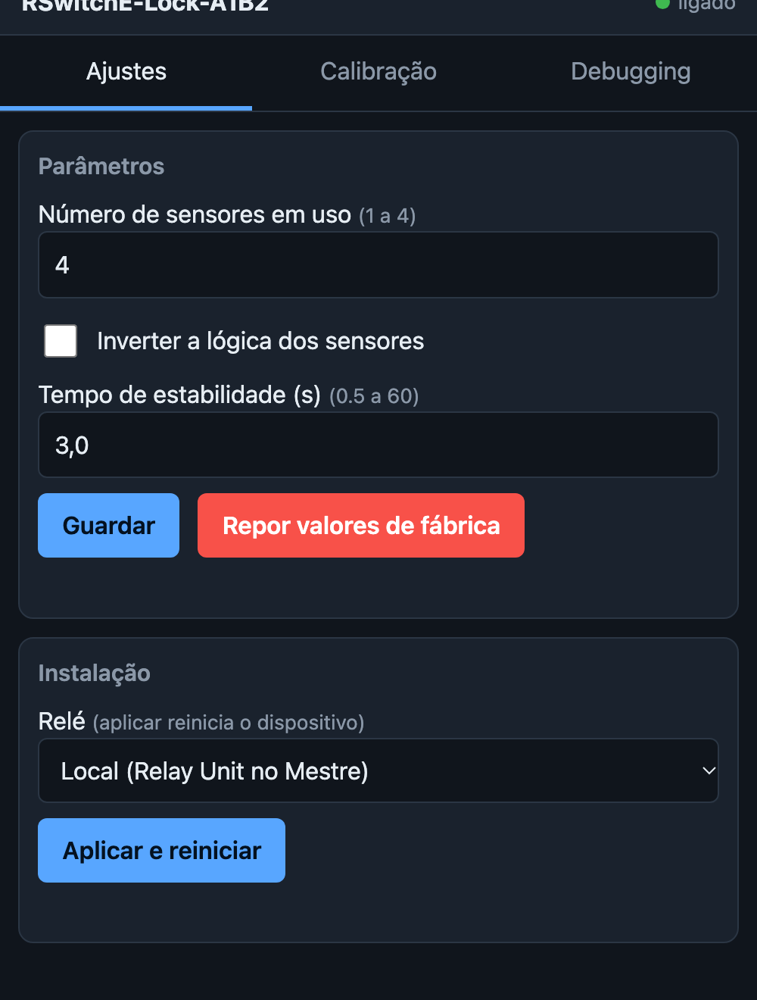
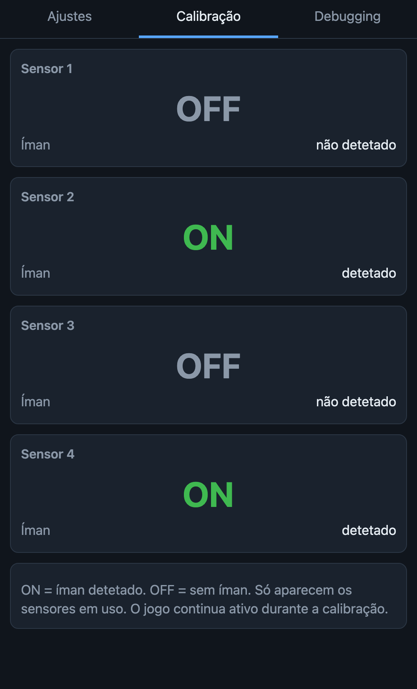
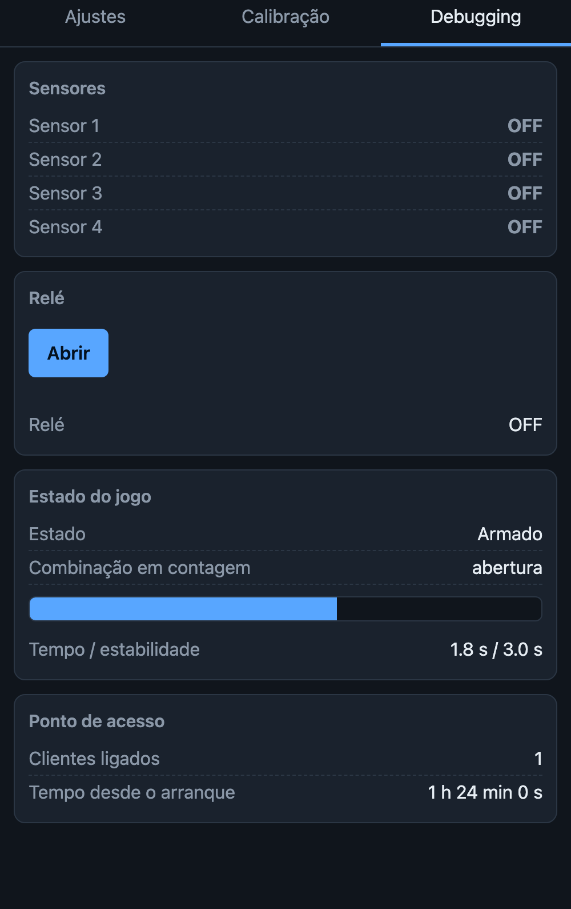
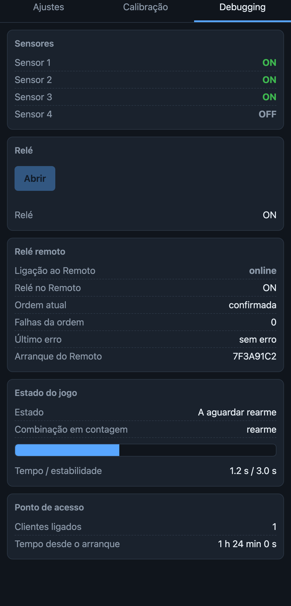

# Manual de utilização — Fechadura por sensores HALL (RSwitchE-Lock)

Este manual explica como usar o sistema no dia a dia: o que ele faz, o que significa o LED e como mudar as definições a partir do telemóvel. A montagem e a atualização do firmware estão no [manual de instalação](Manual_Instalacao.md).

## 1. O que o sistema faz

Abre uma fechadura eletromagnética, através de um relé, quando os jogadores retiram as peças dos sensores HALL na combinação certa. Pode ter até quatro sensores. Cada sensor deteta se há um íman junto dele: **ON** quer dizer íman detetado e **OFF** quer dizer sem íman.

O relé pode estar no próprio **Mestre** (instalação local, de fábrica) ou num segundo aparelho, o **Remoto**, que recebe as ordens do Mestre por rádio (instalação remota). O jogo é igual nas duas.

Não é preciso carregar em nada durante o jogo.

## 2. Como funciona

### 2.1 Numeração dos sensores

Cada sensor tem um número fixo, que depende da porta onde está ligado:

| Sensor | Onde liga | Nome na webapp |
|---|---|---|
| 1 | Porta **A** da Port ABC | Sensor 1 |
| 2 | Porta **B** da Port ABC | Sensor 2 |
| 3 | Porta **C** da Port ABC | Sensor 3 |
| 4 | Porta Grove do AtomS3 Lite (fio branco) | Sensor 4 |

Com **N sensores em uso** (Ajustes), o sistema lê sempre os sensores **de 1 a N**. Por isso, ligue os sensores pela ordem das portas:

| Quero usar | Ligue às portas | Número de sensores em uso |
|---|---|---|
| 1 sensor | A | 1 |
| 2 sensores | A e B | 2 |
| 3 sensores | A, B e C | 3 |
| 4 sensores | A, B, C e Grove | 4 |

Um sensor ligado a uma porta de número acima de N é **ignorado**: não entra na combinação e não aparece na Calibração nem no Debugging. Não se pode usar, por exemplo, só as portas B e C: a combinação conta sempre a partir da porta A.

### 2.2 Estados do jogo

O jogo começa com as peças (e os ímanes) sobre os sensores. Com N sensores em uso, sem inversão:

- **Abertura:** todos os sensores de 1 a N **sem íman** ao mesmo tempo (peças retiradas).
- **Rearme:** todos os sensores de 1 a N **com íman** ao mesmo tempo (peças colocadas).

Com a **inversão** ligada, as duas combinações trocam-se.

| Estado | O que acontece |
|---|---|
| **Armado** | O relé está em repouso e o sistema lê os sensores. É o estado em que arranca sempre. Se a combinação de abertura se mantiver durante o **tempo de estabilidade**, o relé ativa. Se a combinação mudar antes, a contagem é cancelada. |
| **A aguardar rearme** | O relé está ativo e **mantém-se ativo até ao rearme**. O sistema não volta a abrir, mesmo que a combinação de abertura se mantenha. Mexer nas peças não altera o relé. Quando a combinação de rearme se mantém durante o tempo de estabilidade, o relé desativa e o sistema volta a Armado. |

O tempo de estabilidade é de 3 s de fábrica. Alterar os ajustes durante uma contagem reinicia a contagem, mas mantém o estado e o relé.

**Corte de corrente:** ao voltar, o sistema arranca Armado e o relé em repouso. As definições mantêm-se.

**Instalação remota:** a ordem para ativar ou desativar o relé segue para o Remoto, que a confirma. Um rearme cancela uma ordem ainda por confirmar. Ver as secções 6.3 e 7.

## 3. Ligar o sistema

1. Ponha as peças sobre os sensores.
2. Ligue o Mestre à alimentação (e o Remoto, na instalação remota).
3. O LED do Mestre fica **verde fixo**: o sistema está pronto e Armado.

O sistema arranca sempre em **modo Normal**: a rede Wi-Fi de definições está desligada e o jogo corre sozinho.

## 4. O que significa o LED

### 4.1 Mestre

| LED | Significado |
|---|---|
| Verde fixo | Armado |
| Azul fixo | A aguardar rearme (relé ativo) |
| Pulso vermelho de 150 ms a cada 2 s | Sem ligação ao Remoto (só na instalação remota) |

Quando a rede Wi-Fi de definições está ligada, aparecem **pulsos brancos** por cima da cor atual:

| Pulsos brancos | Significado |
|---|---|
| 1 pulso longo a cada 3 segundos | Rede ligada, ainda ninguém ligado |
| 2 pulsos curtos a cada 3 segundos | Rede ligada, há um telemóvel ligado |
| 3 piscas brancos rápidos | O toque longo no botão foi reconhecido |

### 4.2 Remoto

| LED | Significado |
|---|---|
| Verde fixo | Relé em repouso |
| Azul fixo | Relé ativo |
| Pulso vermelho a cada 2 s | Sem pacotes do Mestre há mais de 3 s |

O Remoto arranca sempre com o relé em repouso.

## 5. Abrir a página de definições

A página de definições está no Mestre e abre-se com o telemóvel.

1. No Mestre, carregue no botão e **mantenha 3 segundos** (toque longo). O LED faz 3 piscas brancos e passam a aparecer os pulsos brancos.
2. No telemóvel, ligue-se à rede Wi-Fi **RSwitchE-Lock-XXXX**, com a palavra-passe **mission2escape**. O XXXX é diferente em cada dispositivo e vem no nome da rede.
3. Abra o navegador e escreva **http://192.168.4.1** (com `http`, não `https`).

Se o telemóvel avisar que a rede não tem internet, mantenha a ligação: a página funciona sem internet.

- O **jogo continua a funcionar normalmente** enquanto a rede está ligada.
- A rede **não se desliga sozinha**. Para a desligar, faça outro toque longo de 3 segundos.
- Se faltar a corrente e voltar, a rede começa desligada.
- A palavra-passe é a que está no firmware (`AP_PASSWORD`). Se a mudou na instalação, use a sua.

## 6. A página de definições

O nome do dispositivo aparece no cabeçalho. O indicador mostra "ligado" quando o telemóvel está a falar com o Mestre e "sem ligação" quando perdeu a ligação. A página tem três separadores.

*As imagens deste manual são ilustrativas: mostram a página real, mas com valores simulados.*

### 6.1 Ajustes

**Parâmetros:**

| Definição | Valor de fábrica | Limites | O que faz |
|---|---|---|---|
| Número de sensores em uso | 4 | 1 a 4 | Quantos sensores entram na combinação, do 1 ao N, pela ordem das portas (secção 2.1) |
| Inverter a lógica dos sensores | desligado | — | Troca as combinações de abertura e de rearme. A inversão vale para todos os sensores em uso |
| Tempo de estabilidade | 3 s | 0,5 a 60 s | Tempo que a combinação tem de se manter para abrir ou rearmar |

Para guardar, altere os campos e carregue em **Guardar**. Os valores são verificados em conjunto: se algum não for aceite, a página diz e nada é guardado. As definições ficam guardadas mesmo depois de desligar a corrente.

O botão **Repor valores de fábrica** pede confirmação e repõe os três parâmetros. **Não altera** a instalação (local ou remota).

**Instalação:**

O seletor **Relé** escolhe entre **Local (Relay Unit no Mestre)** e **Remoto (ESP-NOW)**. Carregue em **Aplicar e reiniciar**:

- só funciona com o jogo **Armado**. Fora disso, o botão fica desativado e a página diz "Só é possível mudar com o jogo Armado.";
- a página pede confirmação, porque o dispositivo **reinicia** e o ponto de acesso desliga-se. Volte a ligá-lo com um toque longo;
- se escolher o modo que já está ativo, a página diz "Sem alterações." e não reinicia.

### 6.2 Calibração

Mostra, em direto, um cartão por cada sensor em uso (Sensor 1 é a porta A, Sensor 2 a B, Sensor 3 a C e Sensor 4 a Grove), com **ON** (íman detetado) ou **OFF** (sem íman). Serve para confirmar que cada sensor lê bem, antes de jogar.

**Atenção:** o jogo continua ativo durante a calibração. Se a combinação de abertura se mantiver, o relé ativa.

### 6.3 Debugging

Mostra o estado do sistema. Instalação local:

- **Sensores:** ON ou OFF de cada sensor em uso.
- **Relé:** o botão **Abrir** e o estado do relé (ON ou OFF).
  - **Abrir** só funciona com o jogo Armado e é igual a uma abertura normal: ativa o relé e o jogo passa a "A aguardar rearme". O rearme normal desativa-o. Se a combinação de rearme já se verificar, o relé desativa ao fim do tempo de estabilidade.
- **Estado do jogo:** Armado ou A aguardar rearme, qual combinação está em contagem (abertura, rearme ou sem contagem), uma barra de progresso e o tempo atual sobre o tempo de estabilidade.
- **Ponto de acesso:** quantos telemóveis estão ligados e o tempo desde o arranque.

Na instalação remota aparece também o cartão **Relé remoto**:

| Campo | O que mostra |
|---|---|
| Ligação ao Remoto | **online** (houve pacotes do Remoto nos últimos 3 s) ou **offline** |
| Relé no Remoto | O estado do relé que o Remoto comunicou (ON ou OFF) |
| Ordem atual | **confirmada** ou **por confirmar** (o Remoto ainda não respondeu) |
| Falhas da ordem | Tentativas sem resposta da ordem atual |
| Último erro | O último erro e há quanto tempo, ou "sem erro" |
| Arranque do Remoto | Identificador do arranque do Remoto (muda quando ele reinicia) |

## 7. Erros e o que fazer

Estes erros só existem na instalação remota. Aparecem em **Último erro**, no cartão Relé remoto.

| Mensagem | O que significa | O que fazer |
|---|---|---|
| ordem sem confirmação (5 falhas) | O Remoto não confirmou a ordem à 5.ª tentativa. O Mestre continua a reenviar (a cada 2 s, sem limite) | Veja se o Remoto tem alimentação. Quando ele voltar, aplica a ordem |
| ordem caducada no Remoto | O Remoto esteve 60 s sem pacotes do Mestre com o relé ativo, voltou a repouso e marcou a ordem como caducada | Reveja a ligação e a alimentação do Mestre. Reponha as peças (rearme) e abra de novo |
| Remoto sem pacotes (ordem caducada) | O Mestre esteve 60 s sem pacotes do Remoto com a ordem ativa e deu-a por caducada. O jogo fica em "A aguardar rearme" e não reabre | Veja a alimentação do Remoto. Quando ele voltar, recebe a ordem de repouso. Reponha as peças (rearme) e abra de novo |

**Perda de ligação durante o jogo:**
- **Remoto desligado na abertura:** o Mestre reenvia a ordem. Quando o Remoto volta, o relé ativa.
- **Mestre desligado com o relé ativo:** ao fim de 60 s o relé do Remoto volta a repouso. Quando o Mestre volta, arranca Armado e a ordem caducada **não** reativa o relé. Só uma nova abertura, depois de um rearme, o ativa.
- **Remoto desligado com o relé ativo:** o jogo fica em "A aguardar rearme" depois dos 60 s, e só reabre depois de um rearme.

Em caso de dúvida, um reinício do Mestre (desligar e voltar a ligar) repõe o jogo Armado.

## 8. Problemas comuns

| Problema | Causa provável | O que fazer |
|---|---|---|
| O relé não ativa | Combinação incompleta, inversão ligada, N diferente do esperado, ou a contagem foi cancelada | Veja Calibração e Debugging: sensores, combinação em contagem e tempo |
| O relé não desativa | O jogo está em "A aguardar rearme" | Reponha todas as peças (ou retire todas, com inversão) e mantenha o tempo de estabilidade |
| Um sensor não muda | Cabo na porta errada, ou íman fora de alcance | Veja o separador Calibração e a secção 2.1 deste manual |
| Não consigo abrir a página | A rede está desligada, ligou-se à rede errada ou usou `https` | Confirme os pulsos brancos no LED (se não houver, faça o toque longo de 3 s), ligue-se à rede **RSwitchE-Lock-XXXX** e escreva **http://192.168.4.1** |
| A página fica "sem ligação" | O telemóvel saiu da rede, ou a rede foi desligada | Volte a ligar a rede com o toque longo e reabra a página |
| Não consigo mudar para remoto (ou para local) | O jogo não está Armado | Rearme o jogo e tente outra vez |
| Remoto offline | Sem alimentação, MAC ou canal errados | Ver o manual de instalação, secções 4.3 e 5 |

## 9. Resumo

- **Ligar:** peças sobre os sensores, ligar, esperar o LED verde.
- **Abrir as definições:** toque longo de 3 s no Mestre, rede **RSwitchE-Lock-XXXX**, palavra-passe **mission2escape**, endereço **http://192.168.4.1**.
- **Abrir a fechadura:** retirar as peças durante o tempo de estabilidade (3 s de fábrica). Fica aberta até ao rearme.
- **Rearmar:** repor todas as peças durante o tempo de estabilidade.
- **Mudar valores:** separador Ajustes, depois Guardar.
- **Ver o que se passa:** separador Debugging.
- **Se algo falhar:** veja o LED e a secção 7.
